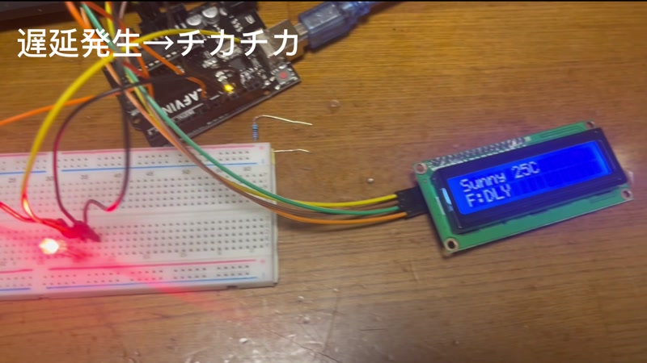

# 電車遅延・天気通知システム

**Arduino × Python ／ 個人制作 ／ コンテスト優秀賞**

## 作ろうと思った理由

朝の忙しい時間に、天気予報や電車の遅延情報を一つずつ調べる手間を減らしたいと思い、このシステムを作りました。「朝、少し元気が出るようなものにしたい」という考えもあり、LINEには情報だけでなく短い挨拶も添えています。

情報を自動で集め、机の上の装置を見れば大まかな状況が分かり、詳しく知りたいときはLINEで確認できる形を目指しました。

## 実際に作った装置

発表動画から切り出した実機の写真です。LCDには天気・気温と路線の状態を表示し、遅延があると「DLY」と表示します。LEDの点滅や色の変化も実機で実演しました。

構想、Pythonのプログラミング、Arduinoの制御、部品の配線、実機での動作確認、コンテストでの発表まで、一人で取り組みました。ハードウェアとソフトウェアを組み合わせた作品として完成させ、優秀賞を受賞しました。

## 表示を3つに分けた理由

| 表示・操作 | 役割 |
| --- | --- |
| LCD | よく使う2路線の状態と天気・気温を短く表示する |
| RGB LED | 文字を読まなくても、色や点滅で変化に気づけるようにする |
| LINE | 遅延の詳細、ほかの5路線、時間帯別の降水確率を確認する |
| 押しボタン | 決まった時間以外でも、その場で情報を更新する |

LCDにすべての情報を詰め込むと読みづらくなるため、装置で確認する情報とLINEで読む詳しい情報を分けています。定時更新だけでなくボタン操作も用意し、知りたいときに自分で更新できるようにしました。

## 発表動画で紹介したこと

- Arduino、LCD、LED、ボタンを接続した実物の構成
- 通常時の表示と、遅延発生時の「DLY」表示・LED点滅
- 天気に応じたLEDの表示
- LINEへの天気・降水確率・複数路線の運行情報の通知
- 発表時の版にあった、ニュース5件をLINEで読む機能

**発表時の版と公開コードについて：** このREADMEの写真はコンテスト発表時の記録です。現在公開しているPythonファイルにはニュース取得処理が含まれていません。また、LEDの具体的な色や判定条件は現在のArduinoスケッチを参照してください。動画で紹介した全機能が、この公開コードに揃っているわけではありません。

## 仕組み

~~~mermaid
flowchart LR
  A[運行情報・天気] --> B[Pythonで取得・解析]
  B --> C[LINE通知]
  B --> D[シリアル通信]
  D --> E[Arduino LCD・RGB LED]
  F[Arduinoのボタン] -->|CHECK| B
~~~

## できること

- 副都心線・東武東上線・山手線・中央線・東西線・丸ノ内線・銀座線の運行情報を取得します。
- 天気、最高気温、時間帯別の降水確率を取得し、傘や雪への注意をLINEに送ります。
- 1日3回の定時更新に加え、Arduinoのボタンを押してCHECK信号を送ると、情報を再取得します。
- 取得失敗や想定外のページ構造を平常運転と誤認しないよう、エラーとして扱います。
- 天気・気温・主要2路線の状態をLCDに表示し、遅延や雨をRGB LEDで知らせます。

## 使用したもの

Python、Arduino、Requests、BeautifulSoup、schedule、PySerial、LINE Messaging API、I2C LCD、RGB LED、押しボタン。

## 起動方法

Python 3を用意し、依存ライブラリを入れます。

~~~sh
pip install -r requirements.txt
~~~

LINE Messaging APIのアクセストークンと通知先ユーザーIDを、環境変数LINE_ACCESS_TOKEN、LINE_USER_IDに設定します。Arduinoのシリアルポートを使う環境では、ARDUINO_PORT（既定値COM5）も必要に応じて変更してください。

~~~text
ARDUINO_PORT=COM5
ARDUINO_BAUD_RATE=9600
LINE_ACCESS_TOKEN=自分のアクセストークン
LINE_USER_ID=自分の通知先ID
~~~

設定後、Arduinoを接続して実行します。

~~~sh
python commute_alert.py
~~~

このスケッチはWire、LiquidCrystal_I2Cを使用します。LCDはI2Cアドレス0x27、シリアル通信は9600 baudを想定しています。RGB LEDは9・10・11番ピン、ボタンは2番ピンに接続する設定です。実物に合わせて配線と設定を確認してください。

## ファイル

- commute_alert.py: 天気・運行情報の取得、解析、LINE通知、Arduinoとの通信
- sketch_jan4a.ino: LCD・RGB LEDの表示と、ボタン操作のスケッチ
- requirements.txt: Pythonの依存ライブラリ

## 今後まとめたいこと

制作中に苦労したことや実際の改善過程、コンテストの正式名称・受賞年は、確認してから追記します。

取得元WebサイトのHTML構造が変わると、情報を取得できなくなる場合があります。利用する際は、鉄道会社・気象機関の公式情報も確認してください。
